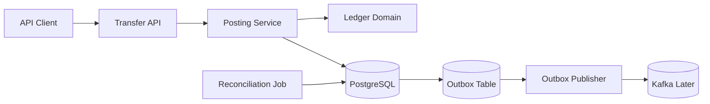
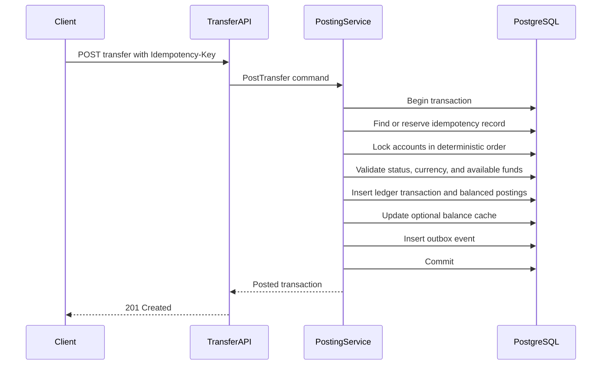

# Java Double-Entry Ledger

A banking-style ledger service that records transfers as immutable, balanced journal entries.

This is not a CRUD account-balance demo. Its purpose is to demonstrate transactional correctness under duplicate requests, concurrent transfers, retries, reversals, and partial failure.

## 1. Learning and portfolio goals

Build evidence of practical experience with:

- Java 21 and Spring Boot
- ACID transactions and explicit database constraints
- Double-entry bookkeeping
- Idempotent financial APIs
- Concurrency control and deadlock avoidance
- Immutable audit history
- Transactional outbox delivery
- Reconciliation and operational recovery
- Integration testing with a real PostgreSQL instance

## 2. Banking use case

The service manages ledger accounts and transfers value between accounts in one currency.

Example:

```text
Transfer NGN 25,000.00 from customer wallet A to merchant wallet B

Debit:  customer wallet A   NGN 25,000.00
Credit: merchant wallet B   NGN 25,000.00
```

The naming of debit and credit depends on the accounting model used for each account type. Internally, the implementation should use signed postings or a clearly documented debit/credit convention and enforce that every transaction balances to zero.

## 3. Scope

### MVP

- Create and retrieve ledger accounts
- Post an internal transfer between two accounts
- Require an idempotency key for every transfer
- Record immutable ledger transactions and postings
- Reject unbalanced journals
- Prevent spending beyond available balance
- Handle concurrent transfers safely
- Retrieve balances and account statements
- Reverse a posted transfer with compensating entries
- Publish committed transaction events through an outbox
- Reconcile cached balances against journal history
- Expose health, metrics, and OpenAPI documentation

### Later extensions

- Holds and available-versus-ledger balances
- Fees and tax postings
- Multi-leg transfers
- Pending settlement and clearing accounts
- External payment-provider callbacks
- Daily balance snapshots
- Multi-currency exchange transactions
- Maker-checker approval

### Non-goals

- Connecting to a real bank or payment provider
- Storing card details or banking credentials
- Supporting foreign exchange in the MVP
- Deleting or editing posted transactions
- Building a user-facing frontend
- Claiming regulatory or PCI-DSS compliance

## 4. Architecture



### Transfer posting flow



No success response may be returned before the database transaction commits.

## 5. Technology baseline

- Java 21
- Maven with Maven Wrapper
- Spring Boot
- Spring Web MVC
- Spring Validation
- Spring Data JPA
- PostgreSQL
- Flyway
- Spring Security OAuth2 Resource Server
- Spring Boot Actuator
- Micrometer and Prometheus registry
- Springdoc OpenAPI
- JUnit 5, AssertJ, Mockito
- Testcontainers for PostgreSQL
- Docker Compose

Select compatible versions when initializing the project.

## 6. Maven dependencies to select

Use Spring Initializr as the starting point with:

- Spring Web
- Validation
- Spring Data JPA
- PostgreSQL Driver
- Flyway Migration
- OAuth2 Resource Server
- Actuator
- Prometheus
- Testcontainers

Add Springdoc OpenAPI and a formatting/static-analysis tool after the first vertical slice works.

## 7. Domain model

### Account

Suggested fields:

- `id`
- `externalReference`
- `name`
- `accountType`
- `currency`
- `status`
- `cachedBalanceMinor`
- `version`
- `createdAt`
- `updatedAt`

Account status:

```text
ACTIVE -> FROZEN -> CLOSED
```

Closed accounts cannot be reopened in the MVP. Frozen accounts may be readable but cannot participate in new transfers.

### Ledger transaction

Suggested fields:

- `id`
- `reference`
- `type`
- `status`
- `currency`
- `description`
- `idempotencyKey`
- `requestHash`
- `reversalOfTransactionId`
- `createdAt`
- `postedAt`

Transaction types:

- `TRANSFER`
- `REVERSAL`
- `ADJUSTMENT` reserved for controlled administrative use later

Transaction states:

```text
PENDING -> POSTED
PENDING -> FAILED
POSTED -> REVERSED
```

The original posted row remains immutable when reversed.

### Posting

Each transaction has at least two postings:

- `id`
- `transactionId`
- `accountId`
- `direction` or `signedAmountMinor`
- `amountMinor`
- `currency`
- `createdAt`

Choose one internal representation:

1. Positive `amountMinor` plus `DEBIT`/`CREDIT`, or
2. Signed `amountMinor`, where all postings for a transaction must sum to zero.

The signed representation makes the balancing invariant straightforward. The API can still expose debit/credit terminology.

### Idempotency record

Suggested fields:

- `idempotencyKey`
- `operation`
- `requestHash`
- `status`
- `resourceId`
- `responseCode`
- `responseBody`
- `createdAt`
- `expiresAt`

Reusing a key with a different request hash must return `409 Conflict`.

### Outbox event

Suggested fields:

- `id`
- `aggregateType`
- `aggregateId`
- `eventType`
- `payload`
- `occurredAt`
- `publishedAt`
- `attemptCount`
- `lastError`

The ledger commit and outbox insertion must happen in the same PostgreSQL transaction.

Initial integration events:

- `LedgerTransactionPosted`
- `LedgerTransactionReversed`
- `LedgerReconciliationMismatchDetected`

`LedgerTransactionPosted` represents the complete balanced journal. Do not publish separate debit and credit success events that could make consumers believe one side committed independently.

## 8. Core invariants

Enforce and test these rules:

1. Every posted transaction has at least two postings.
2. Posting amounts are non-zero.
3. All postings in a transaction use the transaction currency.
4. The signed sum of all postings in a transaction is zero.
5. Source and destination accounts are different.
6. Both accounts are active and use the requested currency.
7. An account cannot spend beyond its available balance.
8. A successful idempotency key identifies exactly one logical result.
9. A reversal references a posted transaction and is itself balanced.
10. A transaction cannot be reversed more than once in the MVP.
11. Posted transaction and posting records cannot be updated or deleted.
12. Cached balances, when used, change in the same transaction as the journal.

Some cross-row invariants cannot be expressed with a simple `CHECK` constraint. Protect them through the posting service, database transaction boundaries, locked queries, and reconciliation tests.

## 9. Money representation

Use integer minor units for the MVP:

```json
{
  "amountMinor": 2500000,
  "currency": "NGN"
}
```

That represents NGN 25,000.00.

Rules:

- Use `long` in Java and `BIGINT` in PostgreSQL.
- Validate that the amount is positive and below a documented maximum.
- Use ISO 4217 currency codes.
- Never use `double` or `float`.
- Keep formatting out of the domain model.

## 10. API contract

Base path: `/api/v1`

### Create an account

```http
POST /api/v1/accounts
Content-Type: application/json

{
  "externalReference": "customer-123",
  "name": "Customer Wallet",
  "accountType": "CUSTOMER_WALLET",
  "currency": "NGN"
}
```

### Post a transfer

```http
POST /api/v1/transfers
Idempotency-Key: 7d9c7c37-7ad4-449c-a52c-880a1f74db50
Content-Type: application/json

{
  "sourceAccountId": "acc-source",
  "destinationAccountId": "acc-destination",
  "amountMinor": 2500000,
  "currency": "NGN",
  "reference": "order-10452",
  "description": "Merchant settlement"
}
```

Expected responses:

- `201 Created` for a newly posted transfer
- The original successful response for an identical idempotent retry
- `400 Bad Request` for invalid input
- `409 Conflict` for insufficient funds, invalid account state, or changed idempotent payload
- `404 Not Found` for unknown accounts

### Retrieve transaction

```http
GET /api/v1/transactions/{transactionId}
```

### Retrieve balance

```http
GET /api/v1/accounts/{accountId}/balance
```

Return both ledger and available balance even if they are equal in the MVP. This avoids breaking the API when holds are introduced.

### Retrieve statement

```http
GET /api/v1/accounts/{accountId}/statement?from=2026-01-01&to=2026-01-31&page=0&size=50
```

Use cursor pagination later if the data volume makes offset pagination unsuitable.

### Reverse transfer

```http
POST /api/v1/transactions/{transactionId}/reversals
Idempotency-Key: f2c48373-d6de-4853-9c71-b95de183530a
Content-Type: application/json

{
  "reason": "Duplicate merchant settlement"
}
```

## 11. Concurrency strategy

For a transfer:

1. Sort the two account IDs.
2. Lock both account rows in that deterministic order using `SELECT ... FOR UPDATE`.
3. Validate balances and account states after acquiring the locks.
4. Insert the transaction, postings, balance updates, and outbox event.
5. Commit.

Deterministic lock ordering reduces deadlocks. Still detect PostgreSQL deadlock or serialization failures and retry the entire transaction a small, bounded number of times.

Do not retry requests blindly at the HTTP layer. Retry only through the idempotent application command.

## 12. Proposed package structure

```text
src/
├── main/java/com/yussufajao/ledger/
│   ├── LedgerApplication.java
│   ├── account/
│   │   ├── api/
│   │   ├── application/
│   │   ├── domain/
│   │   └── infrastructure/
│   ├── transaction/
│   │   ├── api/
│   │   ├── application/
│   │   ├── domain/
│   │   └── infrastructure/
│   ├── idempotency/
│   ├── outbox/
│   ├── reconciliation/
│   ├── security/
│   ├── observability/
│   └── common/
└── test/
    ├── java/
    └── resources/
```

Keep business invariants in domain/application code rather than controllers or JPA callbacks.

## 13. Database migrations

Create migrations incrementally:

1. Accounts
2. Ledger transactions
3. Postings
4. Idempotency records
5. Outbox events
6. Immutability triggers or restricted database permissions
7. Indexes for statements, references, outbox polling, and reconciliation

Important indexes:

- Unique account external reference plus currency, if required
- Unique transaction reference
- Unique idempotency key plus operation
- Postings by account and creation time
- Unpublished outbox events by occurrence time
- Unique `reversal_of_transaction_id` where not null

## 14. Implementation roadmap

### Phase 0: Write the decisions

- Define the account types and debit/credit convention.
- Choose signed postings or explicit directions.
- Define whether balances are derived only or cached.
- Record the decisions in ADRs.

Exit criterion: the balancing equation and account semantics can be explained with examples.

### Phase 1: Bootstrap

- Generate the Maven Spring Boot project.
- Add Docker Compose with PostgreSQL.
- Add Flyway and the first migration.
- Configure profiles for local and test environments.
- Add health and readiness endpoints.

Exit criterion: the application starts, migration runs, and PostgreSQL Testcontainer test passes.

### Phase 2: Accounts

- Implement account creation and retrieval.
- Add status and currency validation.
- Add account uniqueness rules.
- Document the API with OpenAPI.

Exit criterion: account API integration tests pass.

### Phase 3: First balanced transfer

- Implement transaction and posting domain types.
- Add the transactional posting service.
- Persist two balanced postings atomically.
- Retrieve a transaction and statement.

Exit criterion: no code path can persist only one side of a transfer.

### Phase 4: Idempotency

- Require `Idempotency-Key`.
- Hash the canonical request payload.
- Store and replay successful responses.
- Reject reuse with a changed payload.
- Handle concurrent requests using the same key.

Exit criterion: sending the same request concurrently creates one transfer.

### Phase 5: Balance and concurrency safety

- Add row locking in deterministic order.
- Enforce sufficient funds.
- Add bounded retries for database deadlocks.
- Test opposing concurrent transfers.
- Test high-contention debit attempts.

Exit criterion: balances never become invalid and total value remains constant.

### Phase 6: Reversals

- Post compensating entries instead of editing history.
- Link reversal and original transactions.
- Prevent duplicate reversal.
- Add reversal authorization scope.

Exit criterion: reversing a transfer restores account balances and preserves both records.

### Phase 7: Outbox

- Insert an event in the ledger transaction.
- Implement a polling publisher abstraction.
- Mark events published only after successful delivery.
- Make the publisher safe under multiple instances.

Exit criterion: a committed transfer cannot exist without its outbox event.

### Phase 8: Reconciliation

- Derive each account balance from postings.
- Compare derived values with the balance cache.
- Emit metrics and a report for mismatches.
- Add a controlled repair command that is disabled by default.

Exit criterion: deliberately corrupted cached data is detected.

### Phase 9: Security and observability

- Validate JWTs and scopes.
- Add correlation IDs.
- Add structured audit logs.
- Add metrics for posting latency, failures, conflicts, idempotent replays, outbox backlog, and reconciliation mismatches.
- Prevent sensitive request data from entering logs.

Exit criterion: one transfer can be traced through logs, metrics, transaction records, and outbox.

### Phase 10: Delivery

- Add Maven verification and formatting.
- Add GitHub Actions.
- Add Docker image build.
- Add reproducible demo script.
- Record a failure/recovery demo.
- Document limitations and trade-offs.

Exit criterion: a reviewer can clone, start, test, and exercise the service from the README.

## 15. Testing strategy

### Unit tests

- Posting balance calculation
- Money and currency validation
- State transitions
- Request hashing
- Reversal construction

### PostgreSQL integration tests

- Atomic transfer commit and rollback
- Database constraints
- Duplicate idempotency keys
- Concurrent identical requests
- Concurrent debits from one account
- Deadlock retry behavior
- Statement ordering and pagination
- Outbox atomicity
- Reconciliation mismatch detection

Use Testcontainers. Do not substitute H2 for PostgreSQL transaction and locking tests.

### Property-based tests

Generate sequences of valid transfers and assert:

- Total value is conserved.
- Every transaction balances.
- No successful transfer creates a negative spendable balance.
- Replaying a request does not change balances.

### Failure tests

- Process stops before commit
- Process stops after commit but before response
- Outbox broker is unavailable
- Two service instances publish concurrently
- Reconciliation runs during posting
- Database deadlock occurs

## 16. Security checklist

- OAuth2/JWT validation with issuer and audience checks
- Scopes for account read, transfer post, reversal, and reconciliation
- No client-supplied account balance
- Strict request-size and amount limits
- Idempotency keys treated as untrusted input
- Audit actor, action, resource, timestamp, and correlation ID
- Secrets loaded from environment or a secret manager
- No sensitive values in logs or metrics labels
- Dependency and container scanning in CI

## 17. Observability

Minimum metrics:

- Transfer attempts and outcomes
- Transfer posting duration
- Insufficient-funds conflicts
- Idempotent replay count
- Database deadlock retries
- Reversal count
- Outbox unpublished count and oldest age
- Reconciliation mismatches

Log fields:

- `timestamp`
- `level`
- `service`
- `correlationId`
- `transactionId`
- `accountId` only where safe
- `event`
- `outcome`
- `durationMs`

Do not use high-cardinality transaction IDs as Prometheus labels.

## 18. Local development target

The finished project should support:

```bash
docker compose up -d
./mvnw flyway:migrate
./mvnw spring-boot:run
./mvnw verify
```

Provide a script or HTTP file that:

1. Creates two accounts
2. Funds the source through a controlled opening-balance transaction
3. Posts a transfer
4. Replays the transfer with the same idempotency key
5. Retrieves balances and statements
6. Reverses the transfer
7. Shows the audit and outbox records

## 19. Completion checklist

- [ ] Every posted transaction is balanced
- [ ] Posting and outbox insertion are atomic
- [ ] Duplicate requests cannot create duplicate transfers
- [ ] Concurrent spending cannot violate balance rules
- [ ] Posted history is immutable
- [ ] Reversals use compensating entries
- [ ] Reconciliation detects balance drift
- [ ] PostgreSQL integration tests cover failure paths
- [ ] Metrics and structured logs expose system health
- [ ] Security boundaries and scopes are documented
- [ ] CI runs the full verification build
- [ ] Local setup and demo are reproducible

## 20. Interview talking points

Be prepared to explain:

- Why double-entry is safer than updating two balance columns
- Why idempotency is required even with database transactions
- How deterministic locking prevents lost updates and reduces deadlocks
- What happens if the process crashes after commit but before responding
- Why reversals are preferable to editing financial history
- How the outbox closes the database/broker dual-write gap
- Why reconciliation is still required after adding invariants
- Which guarantees are provided by PostgreSQL and which remain application responsibilities
